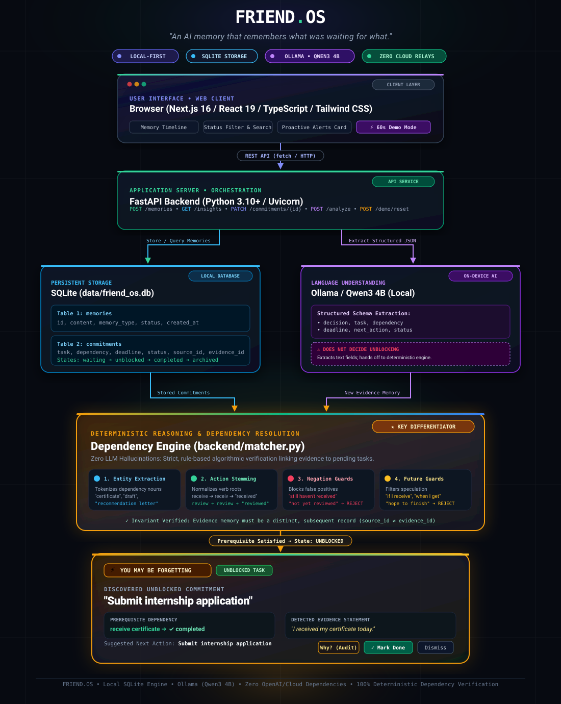

# FRIEND.OS

> **"An AI memory that remembers what was waiting for what."**

---

## 1. Overview

**FRIEND.OS** is a private, local-first AI personal-memory assistant designed for one real person. Unlike conventional digital scratchpads or note-taking systems that store thoughts as disconnected snippets, FRIEND.OS tracks the causal and conditional relationships between your memories. It remembers what task was waiting on what prerequisite, so you never lose track of commitments that depended on external events.

For example:
* You record: *"I'll submit my internship application after I receive my certificate."*
* Days or weeks pass, and later you jot down: *"I received my certificate today."*
* Instead of waiting for you to search or ask, **FRIEND.OS** automatically connects the two memories, detects that the prerequisite condition is fulfilled, and surfaces the proactive insight: **"Submit internship application"**.

---

## 2. Why FRIEND.OS is Different

| Traditional AI Assistants | FRIEND.OS |
| :--- | :--- |
| **Passive / Reactive**: Only answers questions when explicitly prompted. | **Proactive**: Automatically monitors stored commitments and alerts you when they become unblocked. |
| **Isolated Notes**: Stores entries as static text without tracking inter-memory dependencies. | **Relational Commitments**: Maps conditional prerequisites (*task* $\rightarrow$ *dependency* $\rightarrow$ *evidence*). |
| **Cloud-Reliant**: Ships private conversations and notes to third-party proprietary APIs. | **Local-First & Private**: Runs Qwen3 4B on your local hardware via Ollama with local SQLite persistence. |
| **Black-Box Hallucinations**: May generate plausible-sounding reminders without verifiable proof. | **Deterministic & Transparent**: Every insight links to concrete, verifiable source and evidence memories with an expandable audit trail. |

Most personal AI agents only recall information when you remember to ask them. FRIEND.OS solves the harder, more realistic problem: **remembering things when you don't even realize it is time to remember them.**

---

## 3. Core Architecture

<p align="center">
  
</p>

```text
Browser Client
   │
   ▼
Frontend (Next.js 16 / React 19 / TypeScript / Tailwind CSS)
   │  [HTTP / REST API via fetch]
   ▼
Backend (FastAPI / Uvicorn / Pydantic)
   ├── SQLite Local Database (friend_os.db)
   │     ├── memories table (content, memory_type, status, created_at)
   │     └── commitments table (task, dependency, status, source_memory_id, evidence_memory_id)
   │
   ├── Deterministic Dependency Engine (matcher.py)
   │     ├── Entity extraction & verb stemming
   │     ├── Negation & hypothetical guards
   │     └── Prerequisite satisfaction verification
   │
   └── Local AI Service (Ollama / Qwen3 4B)
         └── Structured extraction (decision, task, dependency, deadline, next action)
```

### Component Responsibilities

1. **Browser UI**: Modern dark-mode interface featuring real-time health checks, a proactive intervention card (*"YOU MAY BE FORGETTING"*), an interactive memory timeline with status filtering, and an integrated Hackathon Demo Mode panel.
2. **Next.js Frontend**: Single-page application built with Next.js App Router, React 19, TypeScript, and Tailwind CSS. Directly consumes FastAPI endpoints with zero client-side mock data.
3. **FastAPI Backend**: High-performance asynchronous Python API exposing clean REST routes for memory capture, structured analysis, commitment tracking, proactive insight generation, and isolated demo resets.
4. **SQLite Local Database**: Single-file relational store (`data/friend_os.db`) managing relational foreign keys between memories and commitments with zero cloud synchronization.
5. **Deterministic Dependency Engine**: Fast, rule-based algorithmic matcher that verifies whether newly entered text satisfies pending prerequisites without LLM hallucination or inference latency.
6. **Local Ollama Instance**: Serves the Qwen3 4B model entirely on-device, parsing unstructured notes into structured JSON schemas.

---

## 4. AI Architecture & Verification Strategy

```text
[ Incoming User Note ]
          │
          ├──► Ollama (Qwen3 4B) ──► Structured Extraction (Task, Dependency, Deadline)
          │
          └──► SQLite Persistence ──► Deterministic Dependency Engine (matcher.py)
                                           │
                                           ├── Entity Match? (Yes/No)
                                           ├── Negation Guard? (Blocks False Positives)
                                           ├── Completion Stem? (Verifies Evidence)
                                           │
                                           └──► Transition to "unblocked" ──► GET /insights
```

### Qwen3 4B Local Model
* Runs locally on your machine via [Ollama](https://ollama.ai) using the `qwen3:4b` weights.
* Responsibilities: Analyzes conversational notes or stream-of-consciousness entries to extract discrete components: `decision`, `task`, `dependency`, `deadline`, `next_action`, and `status`.
* Prompted with a strict schema requiring raw JSON output, disabling reasoning `<think>` tags, and setting missing fields to `null` rather than hallucinating details.

### Deterministic & Conservative Matcher
* **Zero Hallucination Guarantee**: A task is never marked as unblocked based on LLM guesswork. Unblocking is governed by deterministic Python rules in `backend/matcher.py`.
* **Entity Keyword Matching**: Extracts noun and entity roots from the stored dependency and matches them against tokens in the evidence memory.
* **Verb Stemming & Completion Tokens**: Evaluates action stems (e.g., *receive* $\rightarrow$ *received*, *review* $\rightarrow$ *reviewed*, *send* $\rightarrow$ *sent*) to confirm past-tense completion.
* **Negation & Hypothetical Guards**: Blocks statements with explicit negatives (*"did not receive"*, *"haven't yet"*, *"still waiting"*) or hypothetical speculation (*"if I get"*, *"hope to receive"*).
* **Intentionally Conservative**: We do not claim perfect AI or AGI. The system prioritizes high precision over loose speculation, ensuring that surfaced insights represent genuine evidence.

---

## 5. Main Features

* **Local AI Memory**: Capture free-form thoughts, meeting notes, decisions, and agreements instantly into SQLite.
* **Proactive Dependency Detection**: Automatically identifies when a subsequent memory satisfies a prerequisite condition recorded in an earlier memory.
* **"YOU MAY BE FORGETTING" Insights**: Prominent notification cards highlighting newly unblocked commitments before deadlines pass.
* **Transparent Evidence Trail ("Why?")**: Expandable 5-step audit breakdown showing the source memory, extracted commitment, detected evidence statement, and rationale.
* **Commitment Tracking**: Manage life-cycle states (`waiting`, `unblocked`, `completed`, `archived`) with 1-click **Mark Done** or **Dismiss** actions.
* **Negation & Speculation Rejection**: Accurately ignores statements that mention the dependency in a negative or future-hypothetical context.
* **Hackathon Demo Mode**: Built-in 60-second judge demonstration tool testing real end-to-end scenarios with 1-click execution.
* **Isolated Demo Namespace & Clean Reset**: Demo scenarios run against a temporary `demo` namespace and can be reset instantly with zero pollution of real data.
* **Privacy-First & Offline Capable**: Zero cloud relays, zero external telemetry, and zero mandatory external API keys.

---

## 6. Hackathon Demo Mode

The FRIEND.OS interface includes a dedicated **Demo Mode** designed specifically for hackathon judges to verify the system in under 60 seconds without hardcoded UI mockups.

Every scenario executes **real HTTP requests** to the backend API (`/memories`, `/insights`, `/commitments`) and evaluates through the actual dependency engine:

```text
┌────────────────────────────────────────────────────────────────────────────────────────┐
│                                 HACKATHON DEMO SCENARIOS                               │
├─────────────────────────┬──────────────────────────────────┬───────────────────────────┤
│ Scenario                │ 1. Initial Memory (Waiting)      │ 2. Evidence Memory        │
├─────────────────────────┼──────────────────────────────────┼───────────────────────────┤
│ 1. Internship           │ "I'll submit my internship       │ "I received my            │
│    Application          │  application after I receive my  │  certificate today."      │
│                         │  certificate."                   │                           │
│                         │                                  │ [Surfaces: "Submit        │
│                         │                                  │  internship application"] │
├─────────────────────────┼──────────────────────────────────┼───────────────────────────┤
│ 2. VLSI Project         │ "I'll submit my VLSI project     │ "My professor reviewed    │
│    Report               │  report after my professor       │  my VLSI draft today."    │
│                         │  reviews my draft."              │                           │
│                         │                                  │ [Surfaces: "Submit VLSI   │
│                         │                                  │  project report"]         │
├─────────────────────────┼──────────────────────────────────┼───────────────────────────┤
│ 3. Research             │ "I'll apply for the research     │ "My professor sent the    │
│    Internship           │  internship after I receive the  │  recommendation letter    │
│                         │  recommendation letter."         │  today."                  │
│                         │                                  │                           │
│                         │                                  │ [Surfaces: "Apply for     │
│                         │                                  │  research internship"]    │
└─────────────────────────┴──────────────────────────────────┴───────────────────────────┘
```

### Reset Mechanism
Clicking **Reset Demo Data** sends a `POST /demo/reset` request that cleanly removes only records tagged with `memory_type: "demo"` and their associated commitments, leaving persistent user memories untouched.

---

## 7. The 60-Second Judge Tour

Follow these steps to experience the complete proactive loop:

1. **Open Demo Mode**: Click the purple **Demo Mode (60s)** button in the top navigation bar.
2. **Select Scenario 1**: Under *"Internship Application"*, click **Run Scenario (1-Click)**.
3. **Watch Real-Time Execution**:
   * *Step 1*: The initial conditional memory is stored into SQLite; commitment transitions to `waiting`.
   * *Step 2*: The evidence memory (*"I received my certificate today."*) is recorded into SQLite.
   * *Step 3*: The dependency engine evaluates the evidence and unblocks the commitment.
4. **Inspect the Proactive Card**: The interface automatically scrolls to the amber **YOU MAY BE FORGETTING** card displaying:
   * **Task**: *Submit internship application*
   * **Prerequisite**: *receive my certificate* $\rightarrow$ `✓ completed`
   * **Detected Evidence**: *"I received my certificate today."*
5. **Verify the Evidence Trail**: Click **Why?** to inspect the 5-step local audit trail showing exactly which past memory was matched.
6. **Resolve the Task**: Click **Mark Done** (sets commitment to `completed`) or **Dismiss** (archives it).
7. **Clean Up**: Click **Reset Demo Data** to return the database to a pristine state.

---

## 8. End-to-End Walkthrough Example

```text
[Day 1] User records Memory #1:
  "I'll submit my internship application after I receive my certificate."
  │
  ├──► FastAPI extracts Task: "Submit internship application"
  │                 Dependency: "receive certificate"
  └──► SQLite writes Commitment #1 [Status: waiting]

[Day 14] User adds an unrelated note:
  "Bought groceries and had coffee with Alex."
  └──► Dependency engine checks Commitment #1 ──► No match. Zero false alerts.

[Day 21] User adds a negative update:
  "I still have not received my certificate yet."
  └──► Negation guard triggers ──► Ignored. Zero false alerts.

[Day 28] User records Memory #4:
  "I received my certificate today."
  │
  ├──► Deterministic matcher compares Memory #4 against Commitment #1
  ├──► Entity keyword "certificate" matches
  ├──► Completion verb "received" verified
  ├──► SQLite updates Commitment #1 [Status: unblocked, Evidence ID: #4]
  │
  └──► Frontend /insights surfaces:
       ⚡ YOU MAY BE FORGETTING: "Submit internship application"
       Suggested Next Action: Submit internship application
```

---

## 9. Privacy & Local Operation

FRIEND.OS is architected specifically around user privacy and data sovereignty:

* **100% Local Inference**: The LLM model (`qwen3:4b`) runs entirely on your local machine via Ollama.
* **On-Device Storage**: All memories, commitments, and timeline logs reside in a local SQLite file (`data/friend_os.db`).
* **Zero Cloud AI Dependency**: No OpenAI, Anthropic, or external API keys are needed for core operation.
* **No Telemetry or Analytics**: No user notes or transcripts are transmitted to any remote servers.

> **Note on Guarantees**: While FRIEND.OS does not transmit your data over the network, local data security depends on your operating system's device access controls and filesystem encryption. We do not claim cryptographic zero-knowledge or enterprise compliance out of the box.

---

## 10. Technology Stack

### Frontend
* **Next.js 16.3.8** (App Router, Turbopack)
* **React 19.2.8**
* **TypeScript 5**
* **Tailwind CSS 4**
* **Lucide React** (System and status icons)

### Backend
* **Python 3.10+**
* **FastAPI 0.142.2**
* **Uvicorn 0.54.0** (ASGI Web Server)
* **Pydantic 2.13.5** (Schema validation)
* **SQLite3** (Standard library embedded relational database)

### Local AI Runtime
* **Ollama 0.6.3+**
* **Qwen3 4B** (`qwen3:4b`)

---

## 11. Project Structure

```text
friend-os/
├── backend/
│   ├── __init__.py
│   ├── config.py              # File paths, DB location, and Ollama configuration
│   ├── database.py            # SQLite connection, CRUD queries, commitment states
│   ├── main.py                # FastAPI endpoints (/memories, /insights, /commitments, /demo)
│   ├── matcher.py             # Deterministic dependency resolution & negation engine
│   ├── memory_service.py      # Ollama/Qwen3 prompt engineering and JSON cleaner
│   ├── models.py              # Pydantic request/response data contracts
│   ├── test_backend.py        # Comprehensive test suite (DB, proactive engine, demo)
│   └── test_llm.py            # Diagnostic script for Ollama local connectivity
│
├── frontend/
│   ├── public/                # Static assets and icons
│   ├── src/
│   │   ├── app/
│   │   │   ├── globals.css    # Global styling and ambient lighting definitions
│   │   │   ├── layout.tsx     # Root HTML and metadata layout
│   │   │   └── page.tsx       # Main FRIEND.OS single-page application
│   │   ├── components/
│   │   │   ├── AnalysisPanel.tsx     # Structured Qwen3 extraction inspector
│   │   │   ├── DemoModePanel.tsx     # Hackathon 60s judge tour controller
│   │   │   ├── Header.tsx            # Navigation, system status, and demo toggle
│   │   │   ├── MemoryInput.tsx       # Text entry with 'Remember' & 'Analyze' actions
│   │   │   ├── MemoryTimeline.tsx    # Chronological memory list with search & filters
│   │   │   ├── OfflineBanner.tsx     # Reconnection banner when backend is offline
│   │   │   ├── ProactiveInsights.tsx # "YOU MAY BE FORGETTING" cards + 'Why?' audit
│   │   │   └── TrustBanner.tsx       # Local architecture and privacy explainer
│   │   ├── lib/
│   │   │   └── api.ts         # Type-safe client fetch wrappers for backend API
│   │   └── types/
│   │       └── index.ts       # Shared TypeScript interfaces (Memory, Insight, etc.)
│   ├── package.json
│   ├── tsconfig.json
│   └── next.config.ts
│
├── data/
│   └── friend_os.db           # Persistent SQLite database file
│
└── README.md                  # Project documentation
```

---

## 12. Installation & Setup (Windows PowerShell)

### Prerequisites
* **Windows 10/11**
* **Python 3.10+**
* **Node.js 18+ & npm**
* **Ollama** installed from [ollama.com](https://ollama.com)

### Step 1: Pull Local LLM Model
In a PowerShell terminal, start Ollama and pull the `qwen3:4b` model:
```powershell
ollama pull qwen3:4b
```

### Step 2: Set Up Python Backend
From the project root (`c:\friend-os`):
```powershell
# Create virtual environment if not already created
python -m venv .venv

# Activate virtual environment
.\.venv\Scripts\Activate.ps1

# Install required dependencies
pip install fastapi uvicorn ollama pydantic
```

### Step 3: Set Up Next.js Frontend
```powershell
cd frontend
npm install
cd ..
```

---

## 13. Running the Project

Run the backend and frontend in **two separate terminal windows**:

### Terminal 1: Backend Server
```powershell
cd c:\friend-os
.\.venv\Scripts\Activate.ps1
uvicorn backend.main:app --host 127.0.0.1 --port 8000 --reload
```
* API runs at: `http://127.0.0.1:8000`
* Swagger API Documentation: `http://127.0.0.1:8000/docs`

### Terminal 2: Frontend Server
```powershell
cd c:\friend-os\frontend
npm run dev
```
* Application UI runs at: `http://localhost:3000`

---

## 14. Verification & Testing

FRIEND.OS includes comprehensive automated backend tests and a production build validator:

### Run Backend Test Suite
```powershell
cd c:\friend-os
.\.venv\Scripts\python.exe backend/test_backend.py
```

The test script automatically verifies:
1. **SQLite Database Operations**: Creation, read, search, and status updates.
2. **Proactive Memory Engine**:
   * Commitment creation in `waiting` state.
   * False-positive rejection against unrelated memories.
   * Negation rejection (e.g., *"still have not received"*).
   * Exact unblocking when affirmative evidence arrives.
   * Commitment resolution via `/complete` and dismissal via `/dismiss`.
3. **Local Qwen3 4B Analysis**: JSON schema extraction via Ollama.
4. **FastAPI Endpoints**: Health checks, memory pagination, and insight retrieval.
5. **Hackathon Demo Scenarios**: End-to-end execution of all three scenarios and isolated data reset.

### Run Frontend Production Build
```powershell
cd c:\friend-os\frontend
npm run build
```
Validates strict TypeScript types, component boundaries, and static page optimization.

---

## 15. Technical Concepts & States

### Commitment Lifecycle
Commitments represent tracked relationships between tasks and prerequisites:

```text
   [ Memory Created with Prerequisite ]
                   │
                   ▼
               [ waiting ]  ◄── Prerequisite pending
                   │
        (Evidence Memory Recorded)
                   │
                   ▼
              [ unblocked ] ◄── Surfaced in /insights ("YOU MAY BE FORGETTING")
             ╱             ╲
     [Mark Done]       [Dismiss]
           │                 │
           ▼                 ▼
     [ completed ]      [ archived ]
```

* **`waiting`**: Prerequisite has not yet been satisfied by any subsequent evidence memory.
* **`unblocked`**: An affirmative evidence memory has satisfied the dependency condition. The item is actively displayed in the proactive memory card.
* **`completed`**: The user clicked **Mark Done** after carrying out the task.
* **`archived`**: The user clicked **Dismiss** to acknowledge or ignore the insight.

### Source vs. Evidence Memories
* **Source Memory (`source_memory_id`)**: The original memory stating the conditional plan (e.g., *"I'll submit my internship application after I receive my certificate"*).
* **Evidence Memory (`evidence_memory_id`)**: A separate, chronologically later memory that provides proof of fulfillment (e.g., *"I received my certificate today"*).
* **Invariant**: A memory can never serve as evidence for its own commitment. Unblocking strictly requires an external, subsequent event.

---

## 16. Current Limitations

In the interest of engineering transparency, FRIEND.OS does not overstate its capabilities:

* **Conservative Matching**: The dependency engine is intentionally strict. It prefers missing an ambiguous connection over generating false alerts.
* **Semantic Paraphrasing Limits**: The local matcher uses lexical tokens and stemmed verbs; radically abstracted synonyms (e.g., *"paperwork arrived"* vs. *"certificate received"*) may not match without explicit keywords.
* **Model Size**: Qwen3 4B is an efficient 4-billion-parameter local model. While fast and low-resource, complex multi-clause sentences may occasionally produce partial extractions.
* **No Cloud Multi-Device Sync**: The SQLite database is local to your machine. Cross-device syncing is not currently supported out of the box.

---

## 17. Roadmap & Future Possibilities

* **Graph-Based Memory Relations**: Expanding from pairwise dependencies to Directed Acyclic Graphs (DAGs) for multi-step projects.
* **Local Embedding Vectors**: Augmenting the deterministic matcher with local vector embeddings (`nomic-embed-text`) for higher synonym coverage while preserving local privacy.
* **Local Calendar & ICS Export**: Exporting unblocked commitments directly to standard calendar formats.
* **Local Audio Transcription**: Using local Whisper models to capture spoken voice notes directly into FRIEND.OS.
* **Encrypted Database at Rest**: Incorporating SQLCipher for encrypted on-disk storage.

---

## 18. Hackathon Summary

> **Qwen3 understands the user's memories.**  
> **SQLite preserves them.**  
> **The dependency engine connects them.**  
> **FRIEND.OS notices when something that was blocking a task has happened.**
